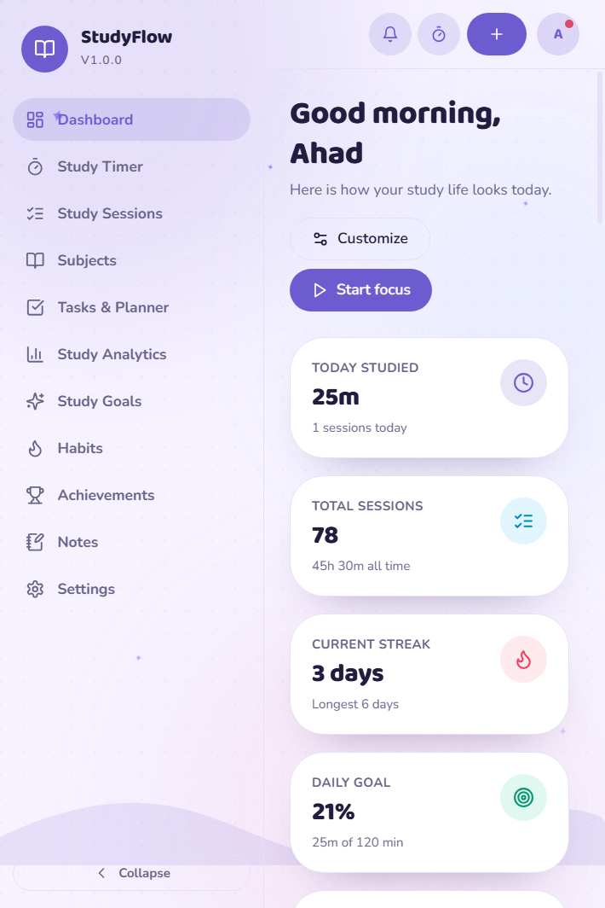

# StudyFlow

An offline desktop study manager for Windows. StudyFlow tracks focus sessions with a
Pomodoro timer, organises subjects, chapters, tasks and habits, and turns the result
into study analytics that come from a local SQLite database — no account, no cloud,
no tracking.



## Features

- **Dashboard** — today's study time, streaks, goal completion, a GitHub-style
  activity heatmap, subject distribution, upcoming tasks, today's schedule, recent
  sessions, active goals and achievement highlights. Widgets can be reordered or
  hidden from the dashboard itself.
- **Pomodoro timer** — timestamp-based countdown that stays accurate while the
  window is minimised, the machine sleeps or the app restarts. Focus, short-break
  and long-break durations, long-break interval, auto-start, three presets, current
  subject and task, circular progress and a distraction-free full-screen mode.
- **Session history** — timer sessions and manual entries, editing, deletion,
  search, subject/type/range filters, per-day totals and duplicate protection.
- **Subjects and chapters** — custom colours and icons, study-hour targets, chapter
  completion, weekly and monthly totals.
- **Tasks and planner** — priority, due dates, estimates, status filters, weekly
  study blocks and an upcoming-deadline list.
- **Goals** — daily, weekly and monthly minutes, per-subject minutes, session counts
  and chapter counts. Break time never counts toward a goal.
- **Habits** — daily toggles, streaks, 30-day completion rate, week and month views.
- **Achievements** — nine milestones, XP, levels and unlock notifications.
- **Notes** — Markdown editing and preview, subject association, pinning, search and
  autosave.
- **Analytics** — daily, weekly and monthly averages, longest session, most studied
  subject, most productive day, focus-versus-break totals, best weekday and CSV or
  JSON export.
- **Settings** — light, dark and system themes, six accent palettes, reduced motion,
  tray behaviour, launch at startup, timer defaults, sound, notifications, database
  backup, restore and data clearing.

## Technology

| Layer | Stack |
| --- | --- |
| Renderer | React 18, TypeScript, Vite 5, Tailwind CSS, shadcn/ui-style primitives on Radix UI, Framer Motion, Recharts, Lucide icons |
| State and forms | Zustand, React Hook Form, Zod |
| Desktop | Electron 33 with context isolation, a validated IPC contract and a sandboxed preload bridge |
| Storage | SQLite through better-sqlite3 with versioned migrations, foreign keys, indexes and WAL |
| Tooling | Vitest, Electron Builder, Inno Setup, GitHub Actions |

## Installation (Windows 10/11, 64-bit)

1. Download `StudyFlow-Setup-1.0.0.exe` from the
   [releases page](https://github.com/Ahaduzzamankhan/study-flow/releases).
2. Run the installer and choose an install directory.
3. Launch StudyFlow from the Start Menu or the desktop shortcut.

A portable build (`StudyFlow-Portable-1.0.0.zip`) is published alongside the
installer, and `StudyFlow-SHA256SUMS.txt` verifies both downloads.

Your study history is stored in `%APPDATA%\StudyFlow\studyflow.sqlite`. It survives
upgrades and uninstalls; remove the folder only if you want a clean slate.

## Development

Requires Node.js 20 or newer and Python 3 is not needed.

```bash
npm ci
npm run dev        # renderer only, with a localStorage development bridge
npm start          # build and launch the real Electron app
```

`npm run dev` is for UI work. Dialogs, the SQLite database, tray behaviour and
notifications only exist inside Electron, so verify those with `npm start`.

### Checks

```bash
npm run typecheck   # renderer and main process
npm test            # 42 unit tests: timer, stats, database, IPC contract, export
npm run build       # production renderer and main-process bundles
```

### Packaging

```bash
npm run icons       # regenerate build/icon.png, icon.ico and size set from icon.svg
npm run dist:win    # Electron Builder Windows package into release/
```

The shipped installer is compiled with Inno Setup from the unpacked build:

```powershell
ISCC.exe /DAppVersion=1.0.0 installer\studyflow.iss
```

## Database

SQLite lives in the Electron user-data directory and is created on first launch.
Migrations are append-only and applied inside a transaction.

| Table | Purpose |
| --- | --- |
| `subjects`, `chapters` | Subjects, colours, targets and chapter completion |
| `study_sessions` | Focus, manual and break sessions with real timestamps |
| `timer_state` | Persisted active timer for crash and restart recovery |
| `tasks` | Task planner fields, priority, due date and completion |
| `goals` | Goal type, target and optional subject |
| `habits`, `habit_completions` | Habits and one row per completed day |
| `notes` | Markdown notes with subject link and pin flag |
| `study_schedules` | Planner blocks by date and minute range |
| `achievements` | Unlocked achievement keys and timestamps |
| `user_settings` | JSON settings document |
| `schema_migrations` | Applied migration versions |

Study time always excludes `short_break` and `long_break` rows, so breaks can be
recorded for focus-versus-break analytics without inflating goals or streaks.

## Project structure

```
studyflow/
├── build/                 icon.svg, icon.png, icon.ico and generated sizes
├── docs/                  README assets
├── electron/
│   ├── main.ts            window, tray, menu, notifications, security
│   ├── preload.ts         contextBridge API
│   ├── database/          connection, migrations, repositories, aggregations
│   ├── ipc/handlers.ts    validated channel handlers and dialogs
│   └── services/          export, backup and restore
├── installer/studyflow.iss
├── shared/                types, IPC contract, stats, achievements, defaults
├── src/
│   ├── components/        UI primitives, layout, forms, heatmap
│   ├── features/          dashboard, timer, sessions, subjects, tasks,
│   │                      analytics, goals, habits, achievements, notes,
│   │                      settings
│   ├── hooks/ stores/ lib/ styles/
├── tests/
└── .github/workflows/release.yml
```

## Releases

Pushing a tag such as `v1.0.0` runs `.github/workflows/release.yml`. The workflow
type-checks, tests, builds, packages the Windows app with Electron Builder, compiles
the Inno Setup installer, creates the portable archive and checksums, and attaches
everything to a GitHub release.

The workflow can also be started manually (**Actions → Release → Run workflow**).
Manual runs upload build artifacts; enable *Publish GitHub release* to create the
tag, release and attached installer from that run.

## Security

- `contextIsolation: true`, `nodeIntegration: false`, no renderer filesystem access.
- Every IPC channel is allow-listed and validated with a Zod schema before a handler
  runs; calls from untrusted frames are rejected.
- Navigation is restricted to the bundled renderer, and external links open in the
  default browser over HTTPS only.
- A Content-Security-Policy limits scripts, styles and connections to the app itself.

## Contributing

See [CONTRIBUTING.md](CONTRIBUTING.md). Bug reports and pull requests are welcome.

## Licence

MIT — see [LICENSE](LICENSE). Changes are listed in [CHANGELOG.md](CHANGELOG.md).
